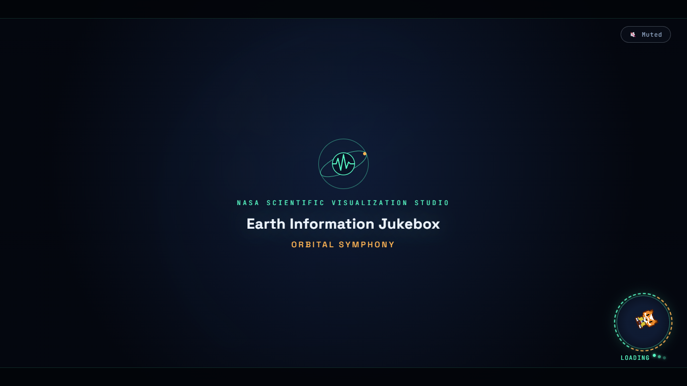
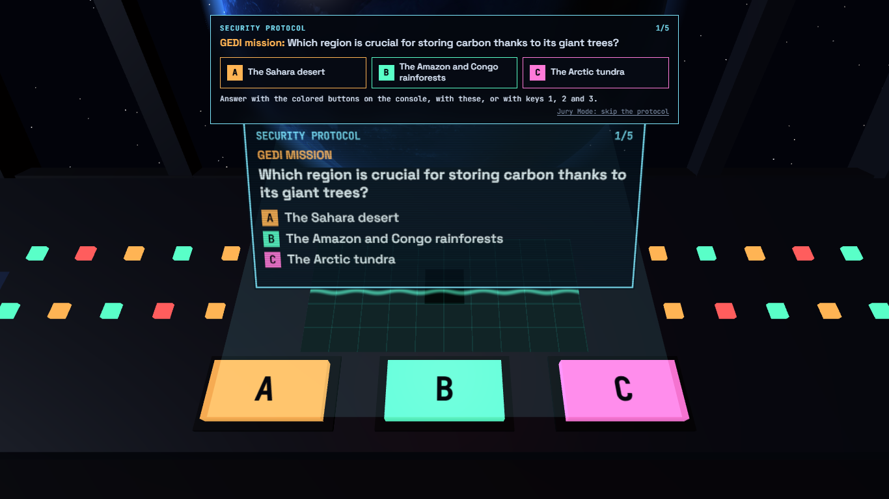
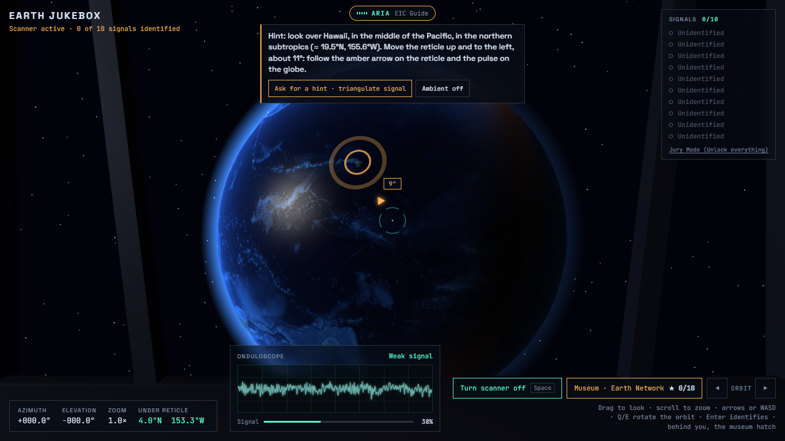
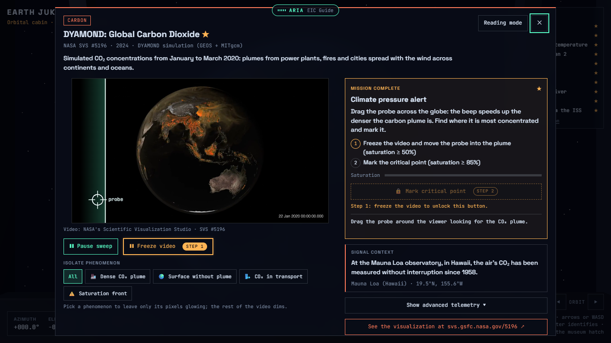
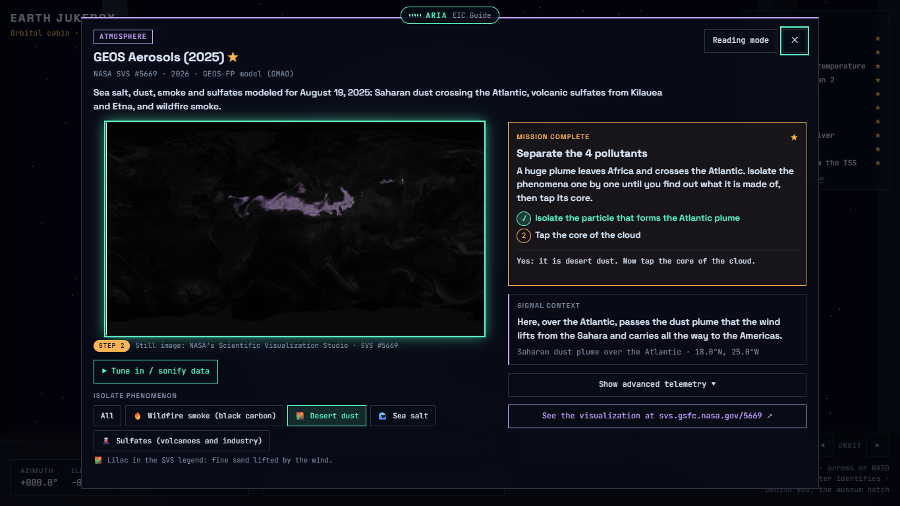
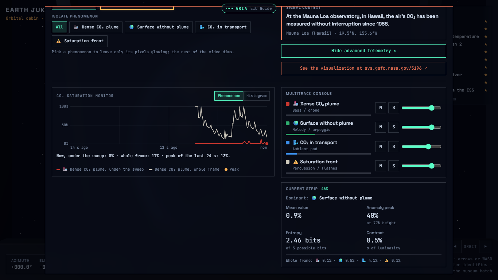
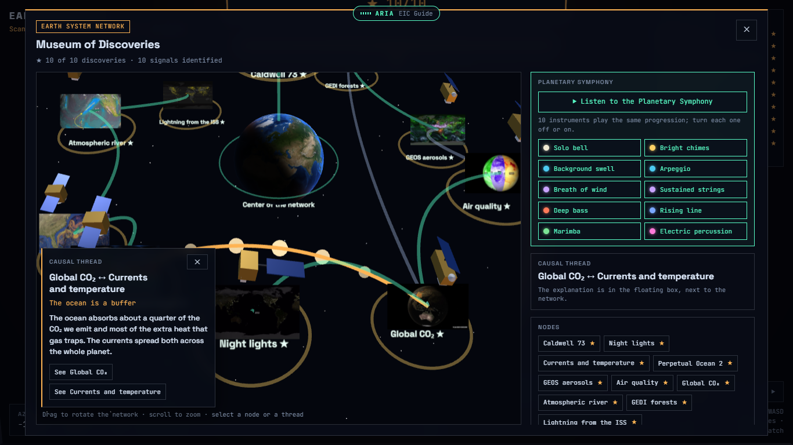
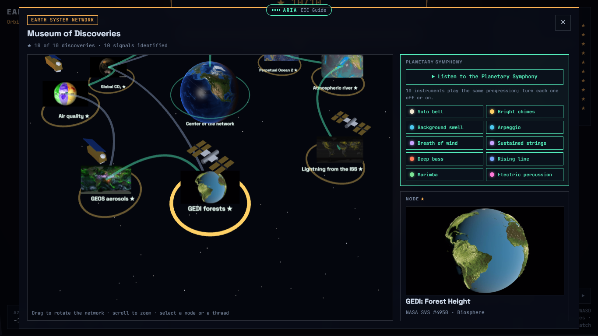

# Earth Information Jukebox

**An interactive 3D experience that turns NASA Earth-science visualizations into sound, play and discovery.**

NASA Space Apps Challenge 2026 · Team **DevDevu**

**Live demo:** <https://stella5555.github.io/DevDevu/> (desktop browser with sound recommended)



---

## Table of contents

1. [Problem statement](#1-problem-statement)
2. [Our solution](#2-our-solution)
3. [How the experience works](#3-how-the-experience-works)
4. [NASA resources used](#4-nasa-resources-used)
5. [Game mechanics](#5-game-mechanics)
6. [Features for the jury](#6-features-for-the-jury)
7. [Accessibility](#7-accessibility)
8. [Controls](#8-controls)
9. [Technology](#9-technology)
10. [Running the project](#10-running-the-project)
11. [Known limitations](#11-known-limitations)
12. [Credits and attributions](#12-credits-and-attributions)
13. [Team](#13-team)
14. [References](#14-references)

---

## 1. Problem statement

Earth observation has never been richer, yet most people cannot read what it shows. Three barriers motivate this project.

**Scientific data is hard to read.** Graphs, maps and color scales assume a level of science literacy and numeracy that much of the public does not have. Sawe, Chafe and Treviño describe these as the *science literacy, numeracy and visualization barriers* of science communication, and argue that data sonification, the translation of data into sound, can carry multidimensional information to audiences that conventional figures do not reach [1].

**Visual-only communication excludes people.** The World Health Organization estimates that at least 2.2 billion people live with a vision impairment or blindness [2]. A visualization that can only be seen is closed to many of them. Research on NASA astronomy data shows the alternative works: in a study with 3,184 blind, low-vision and sighted participants, sonifications produced significant self-reported learning gains and positive responses in both groups [3]. A 2022 review in *Nature Astronomy* catalogued 98 sound-based astronomy projects, of which only 13% listed accessibility as their primary goal [4].

**The Earth is one system, but it is shown in pieces.** Human influence has unequivocally warmed the climate, with global surface temperature in 2011–2020 about 1.1 °C above 1850–1900 [5]. Understanding why requires seeing connections, not isolated maps:

- The ocean absorbed about 2.9 ± 0.4 GtC per year in 2023, roughly a quarter of the 11.1 GtC that human activity emitted [6].
- About 28 million tonnes of Saharan dust reach the Amazon Basin each year, carrying roughly 22,000 tonnes of phosphorus that offset what rain and rivers wash away [7].
- Lightning is not random: it concentrates over tropical land, and Africa is the continent with the most lightning hotspots [8].

NASA's Scientific Visualization Studio (SVS) publishes outstanding visualizations of each of these phenomena. They are, however, passive videos viewed one at a time. The public rarely gets to *interact* with them, *hear* them, or discover *how one relates to another*.

**The question we set out to answer:** can ten NASA visualizations become a single playable, audible experience that a non-specialist can explore in minutes, and that leaves them understanding the Earth as a connected system?

---

## 2. Our solution

**Earth Information Jukebox** places the player in an orbital cabin above a 3D Earth. Ten signals are hidden on the globe, one for each NASA SVS resource. The player finds them by ear, opens each one in an analysis station where the NASA video is converted to music in real time, completes a short mission, and finally connects all ten in a museum that shows how the phenomena cause one another.

The design rests on three pillars:

| Pillar | What the player does | What they take away |
|---|---|---|
| **1. Listen** | Sweeps a scanner over the Earth until static turns into music | Every dataset has its own voice |
| **2. Analyze** | Plays, mixes and isolates the phenomena inside a real NASA video | How a visualization is built and what each color means |
| **3. Connect** | Explores a 3D network of causal links between the ten datasets | The Earth works as one system |

Sound is not decoration. It is the primary channel: the scanner is navigated by ear, each station is a four-track instrument driven by the video's pixels, and the museum ends with all discovered datasets playing together as one piece of music.

---

## 3. How the experience works

### 3.1 Briefing and wake-up sequence

The experience opens with a short cinematic introduction and a five-tip tutorial with looping demonstration videos. On entering the cabin, the onboard assistant **ARIA** wakes the player with a typed, voiced message: a climate anomaly has been detected and navigation is offline.

### 3.2 Security protocol

Before the scanner is unlocked, a hologram on the 3D console asks five questions, one per scientific theme (forest carbon, lightning, Saharan dust, ocean heat transport and the ocean carbon sink). The player answers with the colored console buttons, the on-screen buttons or the keyboard. Wrong answers are not penalized: the protocol is a primer, not a gate. Answering all five restores power to the cabin.



### 3.3 Pillar 1: the orbital cabin and the onduloscope

The player looks around the cabin, zooms and rotates the orbit. With the scanner on, the **onduloscope** plays continuous static. As the reticle approaches a hidden signal, the static clears and that signal's own voice emerges: slow swells for ocean currents, electric crackles for lightning, a rising line for the atmospheric river, and so on. Holding the reticle on a clear signal for 1.5 seconds identifies it.

Signals on the far side of the planet sound muffled until the player rotates the orbit. ARIA can triangulate the nearest unidentified signal on request, describing where it is in plain language and drawing a guide arrow on the reticle.



### 3.4 Pillar 2: the analysis stations

Each identified signal opens a station built around the official NASA SVS video. A sweep line crosses the video and the pixels under it are converted to sound as it moves. Every station offers:

- **Four physical phenomena**, specific to the dataset (for example wildfire smoke, desert dust, sea salt and sulfates for the aerosol model). Each one drives its own audio track.
- **Isolate phenomenon**: dims everything except the pixels of one phenomenon, with a one-line explanation of what its color means in the NASA legend.
- **A mission** with its own mechanic and step-by-step visual guidance (see [section 5](#5-game-mechanics)).
- **Signal context**: one sentence explaining why the signal sits where it does on the globe.
- **Advanced telemetry** (optional): a chart designed for that dataset, a four-track mixing console and live metrics.







### 3.5 Pillar 3: the Museum of Discoveries

A hatch at the rear of the cabin lights up as missions are completed. Behind it, the ten datasets form a 3D network around the Earth. Each node shows a miniature of the spacecraft or instrument behind the data, who measures it, and a scientific conclusion that unlocks with the mission star.

Ten **causal threads** link the nodes. Selecting one sends energy pulses from cause to effect, moves the camera to the link and explains the relationship. The museum ends with the **Planetary Symphony**: every completed dataset plays as one instrument over a shared chord progression, and each can be switched on and off to hear what it contributes.





---

## 4. NASA resources used

All ten resources come from **NASA's Scientific Visualization Studio**. Titles are the official ones on each SVS page.

| SVS ID | Official title | Data behind the visualization | Where the signal hides | Role in the game |
|---|---|---|---|---|
| [13786](https://svs.gsfc.nasa.gov/13786/) | Data Sonification: Caldwell 73 | Hubble Space Telescope image of globular cluster NGC 1851 | NASA Goddard, Maryland (home of the SVS) | Calibration reference: teaches the rule "distance sets pitch, brightness sets volume" |
| [5313](https://svs.gsfc.nasa.gov/5313/) | Change in Night Lights between 2012 and 2023 – EIC Version | Black Marble, VIIRS sensor on Suomi NPP [10] | Indo-Gangetic Plain, India | Time-travel slider from 2012 to 2023 |
| [3912](https://svs.gsfc.nasa.gov/3912/) | Global Sea Surface Currents and Temperature | ECCO2 ocean model | Agulhas Current, southern Africa | Sonic buoy in the ocean flow |
| [5425](https://svs.gsfc.nasa.gov/5425/) | Perpetual Ocean 2: Western Boundary Currents | ECCO2 ocean model | Kuroshio Current, Japan | Sonic buoy in the Gulf Stream |
| [5669](https://svs.gsfc.nasa.gov/5669/) | GEOS Aerosols (2025) | GEOS-FP model | Saharan dust plume over the Atlantic | Separate the four aerosol types |
| [5533](https://svs.gsfc.nasa.gov/5533/) | Air Quality Model Runs | GEOS-CF model | Western Canada, 2024 fire season | Separate the four pollutants |
| [5196](https://svs.gsfc.nasa.gov/5196/) | DYAMOND Global Carbon Dioxide | DYAMOND simulation (GEOS and MITgcm) | Mauna Loa, Hawaii | Saturation probe: mark the critical point |
| [4960](https://svs.gsfc.nasa.gov/4960/) | A 3D View of an Atmospheric River from an Earth System Model | MERRA-2 reanalysis | Northeast Pacific | Saturation probe along the vapor corridor |
| [4950](https://svs.gsfc.nasa.gov/4950/) | GEDI Forest Height | GEDI lidar on the International Space Station [9] | Amazon rainforest | Canopy elevation profile, 0 to 50 m |
| [5011](https://svs.gsfc.nasa.gov/5011/) | Lightning Events Detected from the International Space Station (ISS) 2017-2023 | LIS sensor on the International Space Station | Congo Basin, central Africa | Storm hunter: find the epicenter |

**How the NASA media is used.** Each station plays a short excerpt (6 to 30 seconds, without audio, re-encoded for the web) of the official video, or a still frame where the SVS publishes no video (GEOS Aerosols). The exact source file and time range of every excerpt are listed in [`earth-jukebox/public/svs/CREDITS.md`](earth-jukebox/public/svs/CREDITS.md). The excerpts are served from this site because the analysis reads the video pixels, which browsers only allow for same-origin media.

**What is and is not measured.** The game analyzes the *colors of the visualization*, interpreted with the official SVS legend where one exists. It does not read the underlying scientific data files. The latitude and longitude of each hidden signal are a design choice inspired by what each visualization shows, not a value published by the SVS.

---

## 5. Game mechanics

### 5.1 Finding signals

| Mechanic | Description |
|---|---|
| Proximity scanner | Static fades and the signal's voice rises as the reticle gets closer; a signal meter shows the strength |
| Ten distinct voices | Each dataset has a unique base frequency and a texture that matches its category |
| Identification | Hold the reticle on a clear signal for 1.5 s, or click it |
| Orbit rotation | Signals on the far side are muffled until the orbit is rotated |
| Hints | ARIA locates the nearest unidentified signal, describes the region and draws a guide arrow |
| Progress | Identified signals and completed missions are saved in the browser |

### 5.2 Sonification of the NASA videos

Each video frame is analyzed in the browser. The image is divided into 128 strips; for each strip the game measures how much of each of the four phenomena is present, using color rules written for that dataset.

| Track | Driven by | Sound |
|---|---|---|
| Bass / drone | Phenomenon 1 (for example warm current, dense CO₂ plume) | Low sustained tone |
| Melody / arpeggio | Phenomenon 2 | Notes whose pitch follows the position of the phenomenon |
| Ambient pad | Phenomenon 3 | Soft sustained chord |
| Percussion | Phenomenon 4 and sudden changes | Pulses and flashes |

For Caldwell 73 the sweep is radial and follows NASA's own rule for that sonification: the farther from the center, the higher the pitch.

### 5.3 Missions

Seven mission mechanics cover the ten stations. Each completed mission awards a star (★).

| Mission | Stations | What the player does |
|---|---|---|
| Calibrate the onduloscope | Caldwell 73 | Taps a star near the core (low note) and one far from it (high note) |
| Time travel | Night lights | Slides from 2012 to 2023, then taps where light grew the most |
| Sonic buoy | Sea surface currents, Perpetual Ocean 2 | Drops a buoy in the ocean and holds it over a fast, warm current |
| Separate the 4 pollutants | GEOS aerosols, Air quality | Isolates layers to find what a plume is made of, then taps its core |
| Climate pressure alert | Global CO₂, Atmospheric river | Freezes the video, moves a probe to the most saturated point and marks it |
| Elevation profile | GEDI forest height | Sweeps the rainforest to find the tallest canopy |
| Storm hunter | ISS lightning | Watches the flashes, then holds the cursor over the epicenter |

Missions with two steps guide the player visually: the control to use next pulses with a "Step 1" or "Step 2" label, and a control that depends on an earlier step stays locked until that step is done.

### 5.4 Dataset charts

Each station has a chart suited to its data rather than a generic one: a 2012–2023 timeline for night lights, a north–south thermal profile for the oceans, composition bars for aerosols and air quality, a canopy transect for GEDI, a live saturation monitor for CO₂, the atmospheric river and lightning, and a distance-to-frequency plot for Caldwell 73. A classic histogram is available as an alternative view.

### 5.5 Causal threads in the museum

| Thread | Relationship shown |
|---|---|
| Night lights → Global CO₂ | Urbanization and energy use map onto emission sources |
| Global CO₂ → Air quality | The same combustion emits CO₂ and air pollutants |
| Sea surface currents ↔ Perpetual Ocean 2 | Western boundary currents carry heat toward the poles |
| Perpetual Ocean 2 → Atmospheric river | Warm water evaporates and feeds vapor corridors |
| Atmospheric river → Lightning | Moisture is the fuel of thunderstorms |
| GEOS aerosols ↔ GEDI forests | Fires remove biomass; Saharan dust fertilizes the Amazon [7] |
| Caldwell 73 → Earth | The sonification rule that every other node reuses |
| Global CO₂ ↔ GEDI forests | Forests are standing carbon [9] |
| GEOS aerosols ↔ Air quality | The same smoke seen as climate and as health |
| Global CO₂ ↔ Sea surface currents | The ocean absorbs about a quarter of emitted CO₂ [6] |

---

## 6. Features for the jury

These shortcuts exist so that the whole project can be evaluated in a few minutes.

| Feature | Where | What it does |
|---|---|---|
| **Jury Mode (Unlock everything)** | Signal log, top right of the cabin | Identifies all ten signals and awards all ten stars, opening every station, the full museum and the complete symphony |
| **Jury Mode: skip the protocol** | Security protocol card | Skips the five questions and powers the cabin |
| **Skip** | ARIA terminal | Skips the wake-up cinematic |
| **Ask for a hint** | ARIA panel | Points to the nearest unidentified signal |
| **Restart exploration** | Signal log | Clears all progress; the introduction and the protocol play again on the next load |
| **Show advanced telemetry** | Any station | Reveals the dataset chart, the multitrack console and live metrics |
| **Reading mode** | Any station | Describes in text what is seen and heard |

**Suggested five-minute walkthrough**

1. Open the [live demo](https://stella5555.github.io/DevDevu/), turn the sound on (top right) and go through the five tips.
2. Watch ARIA's wake-up message, then answer the security protocol or skip it.
3. Press <kbd>Space</kbd> to turn on the scanner. Press **Ask for a hint**, follow the arrow and hold the reticle on the signal until it is identified. Press <kbd>Enter</kbd> to open its station.
4. Press **Tune in / sonify data**, try **Isolate phenomenon**, and complete the mission by following the Step 1 and Step 2 labels.
5. Close the station and press **Jury Mode (Unlock everything)**.
6. Open the **Museum**, select a causal thread to see the pulses and the explanation, and press **Listen to the Planetary Symphony**.

Returning visitors skip the introduction and the protocol automatically. To see them again, press **Restart exploration** and reload the page.

---

## 7. Accessibility

Accessibility is part of the problem this project addresses, so it is part of the design.

- **Sound as a primary channel.** Signals can be located by ear, and every dataset is audible.
- **Keyboard operation.** The cabin, the protocol, the stations and the museum can be used without a mouse. The museum lists every node and thread as buttons that mirror the 3D scene.
- **Screen readers.** Controls have text labels; ARIA's messages and mission hints are announced as status updates; dialogs keep keyboard focus inside them.
- **Reading mode.** Each station offers a text description of the video, an explanation of the sound mapping, a live description of the current strip and a data table.
- **Reduced motion.** Typing and pulsing animations are disabled when the operating system requests reduced motion.
- **No time pressure and no penalties.** Missions and protocol questions can be retried freely.

---

## 8. Controls

| Action | Mouse / touch | Keyboard |
|---|---|---|
| Look around | Drag | Arrow keys or <kbd>W</kbd> <kbd>A</kbd> <kbd>S</kbd> <kbd>D</kbd> |
| Zoom | Scroll wheel | |
| Rotate the orbit | Hold ◀ or ▶ | Hold <kbd>Q</kbd> or <kbd>E</kbd> |
| Scanner on / off | **Turn scanner on** button | <kbd>Space</kbd> |
| Identify a signal / open a station / open the hatch | Click | <kbd>Enter</kbd> |
| Answer the security protocol | Console or on-screen buttons | <kbd>1</kbd> <kbd>2</kbd> <kbd>3</kbd> or <kbd>A</kbd> <kbd>B</kbd> <kbd>C</kbd> |
| Play / pause the sweep in a station | **Tune in** button | <kbd>Space</kbd> |
| Close a station or the museum | ✕ | <kbd>Esc</kbd> |

---

## 9. Technology

The project is a static web application with no backend. Everything runs in the browser.

| Area | Technology |
|---|---|
| Interface | React 18 |
| 3D scenes | Three.js with React Three Fiber and Drei; custom GLSL shader for the Earth's day/night side and atmosphere |
| Audio | Web Audio API for the scanner, the station instruments and the symphony; Tone.js for the retro interface sounds |
| Video analysis and charts | Canvas 2D, frame by frame |
| Build and hosting | Vite, GitHub Pages |
| Persistence | Browser local storage |

---

## 10. Running the project

Requirements: Node.js 18 or later.

```bash
git clone https://github.com/stella5555/DevDevu.git
cd DevDevu/earth-jukebox
npm install
npm run dev
```

The development server opens at <http://localhost:5173/DevDevu/>.

```bash
npm run build     # production build in earth-jukebox/dist
npm run deploy    # builds and publishes to GitHub Pages
```

The application lives in [`earth-jukebox/`](earth-jukebox/). The HTML files in the repository root are early prototypes kept for reference.

---

## 11. Known limitations

- The game reads the colors of the published visualizations, not the original scientific data files. Its numbers describe the image and are not scientific measurements.
- ARIA's recorded voice in the introduction is in Spanish; the on-screen text acts as English subtitles.
- The tutorial videos on the loading screen were recorded with an earlier Spanish version of the interface.
- GEOS Aerosols is shown as a still image because the SVS publishes no video for that resource.
- The experience is designed for desktop browsers with WebGL. It works on phones, but the 3D console and the stations are more comfortable on a larger screen.

---

## 12. Credits and attributions

**NASA media.** All visualizations: **NASA's Scientific Visualization Studio** (<https://svs.gsfc.nasa.gov/>). Per-file sources are in [`earth-jukebox/public/svs/CREDITS.md`](earth-jukebox/public/svs/CREDITS.md). NASA does not endorse this project.

**Open-source software.** [React](https://react.dev/), [Three.js](https://threejs.org/), [React Three Fiber](https://r3f.docs.pmnd.rs/), [Drei](https://github.com/pmndrs/drei), [Tone.js](https://tonejs.github.io/), [Vite](https://vite.dev/) and [gh-pages](https://github.com/tschaub/gh-pages).

**Typefaces.** [Space Grotesk](https://fonts.google.com/specimen/Space+Grotesk) and [JetBrains Mono](https://fonts.google.com/specimen/JetBrains+Mono), served by Google Fonts under the SIL Open Font License.

**Other assets.** Earth 3D model (`earth-jukebox/public/earth.glb`), mascot animation, cabin photographs, ARIA voice recording and tutorial videos: provided by the team.

**Inspiration.** *Project Hail Mary* by Andy Weir, *Outer Wilds* by Mobius Digital, and the dialogue style of *Undertale* by Toby Fox.

---

## 13. Team

**DevDevu**

| Member | Role |
|---|---|
| **Hilary Penelope Cruz Cruz** | Lead contributor: architecture, development, experience design and narrative direction |
| Niels | Narrative direction |

---

## 14. References

1. Sawe, N., Chafe, C., & Treviño, J. (2020). Using data sonification to overcome science literacy, numeracy, and visualization barriers in science communication. *Frontiers in Communication, 5*, 46. <https://doi.org/10.3389/fcomm.2020.00046>
2. World Health Organization. (2019). *World report on vision*. Geneva: WHO. <https://www.who.int/publications/i/item/9789241516570>
3. Arcand, K. K., Schonhut-Stasik, J. S., Kane, S. G., Sturdevant, G., Russo, M., Watzke, M., Hsu, B., & Smith, L. F. (2024). A Universe of Sound: Processing NASA data into sonifications to explore participant response. *Frontiers in Communication, 9*, 1288896. <https://doi.org/10.3389/fcomm.2024.1288896>
4. Zanella, A., Harrison, C. M., Lenzi, S., Cooke, J., Damsma, P., & Fleming, S. W. (2022). Sonification and sound design for astronomy research, education and public engagement. *Nature Astronomy, 6*, 1241–1248. <https://doi.org/10.1038/s41550-022-01721-z>
5. Intergovernmental Panel on Climate Change. (2023). *Climate Change 2023: Synthesis Report*. Geneva: IPCC. <https://doi.org/10.59327/IPCC/AR6-9789291691647>
6. Friedlingstein, P., et al. (2025). Global Carbon Budget 2024. *Earth System Science Data, 17*(3), 965–1039. <https://doi.org/10.5194/essd-17-965-2025>
7. Yu, H., et al. (2015). The fertilizing role of African dust in the Amazon rainforest: A first multiyear assessment based on data from Cloud-Aerosol Lidar and Infrared Pathfinder Satellite Observations. *Geophysical Research Letters, 42*(6), 1984–1991. <https://doi.org/10.1002/2015GL063040>
8. Albrecht, R. I., Goodman, S. J., Buechler, D. E., Blakeslee, R. J., & Christian, H. J. (2016). Where are the lightning hotspots on Earth? *Bulletin of the American Meteorological Society, 97*(11), 2051–2068. <https://doi.org/10.1175/BAMS-D-14-00193.1>
9. Dubayah, R., et al. (2020). The Global Ecosystem Dynamics Investigation: High-resolution laser ranging of the Earth's forests and topography. *Science of Remote Sensing, 1*, 100002. <https://doi.org/10.1016/j.srs.2020.100002>
10. Román, M. O., et al. (2018). NASA's Black Marble nighttime lights product suite. *Remote Sensing of Environment, 210*, 113–143. <https://doi.org/10.1016/j.rse.2018.03.017>
11. NASA's Scientific Visualization Studio. (2012–2026). Visualizations #13786, #5313, #3912, #5425, #5669, #5533, #5196, #4960, #4950 and #5011. NASA Goddard Space Flight Center. <https://svs.gsfc.nasa.gov/>
